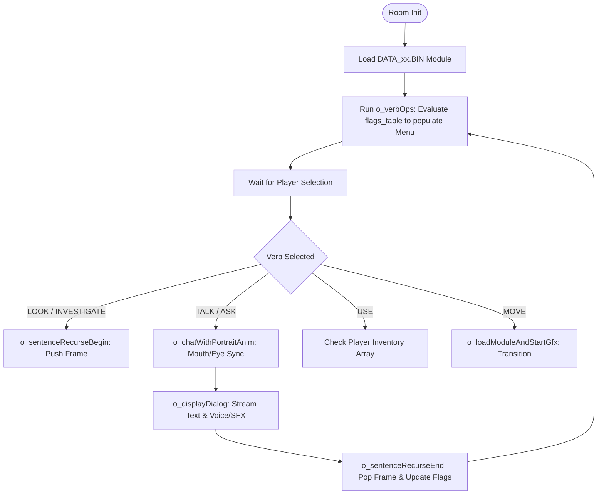

# 03: Boot & Gameplay Implementation Specification

Deterministic technical reference for boot sequences, the core investigation loop, the 3x3 shooting gallery, JORDAN computer terminal, and save/load state serialization.

---

## 1. Boot & Logo Pipeline

### 1.1. Platform Sequences
| Platform | Boot Asset | Decoder / Pipeline | Fade / Timing |
|---|---|---|---|
| **Sega CD** | `StaticRes_SCD::_bootSeqData` | 16-sector VDP nametable tile loader | 30 fade-in, 150 hold, 30 fade-out |
| **PlayStation** | `STR/MX0_S000.STR` | `Video::PSXStreamDecoder` via `PSXRawSectorReadStream` | 168 frames @ 15fps (11.2s total) |
| **Sega Saturn** | `LOGO.TRM` | `Video::AVIDecoder` (TrueMotion 1 codec) | 30fps AVI stream |
| **PC-8801 / MSX2 / PCE** | System font & linear palette | Dynamic banner rendering into frame buffer | 30 fade-in, 150 hold, 30 fade-out |

---

## 2. Core Investigation Loop



---

## 3. Combat: 3x3 Shooting Gallery Engine

The 3x3 shooting gallery represents real-time tactical gunfights against Infiltrators and Snatchers.

### 3.1. Grid Geometry & Coordinates
The screen is divided into 9 targeting sectors:
```
+------------+------------+------------+
|   Sector 1 |   Sector 2 |   Sector 3 |
| (0, 0)     | (1, 0)     | (2, 0)     |
+------------+------------+------------+
|   Sector 4 |   Sector 5 |   Sector 6 |
| (0, 1)     | (1, 1)     | (2, 1)     |
+------------+------------+------------+
|   Sector 7 |   Sector 8 |   Sector 9 |
| (0, 2)     | (1, 2)     | (2, 2)     |
+------------+------------+------------+
```

### 3.2. Peripheral Input Support
- **Standard Joypad / Keyboard:** D-Pad maps directly to 8 directions + Center (Numpad 1..9).
- **Mouse / Pointer:** Coordinate mapping directly projects pointer hit tests onto the active enemy bounding box.
- **Light Gun (Sega CD Justifier / Konami Lightgun):** Immediate raster beam hit calculation matching `m_shooterSequenceRun`.

---

## 4. Sub-Systems

### 4.1. JORDAN Computer Terminal
- **Search Engine:** Text string comparator scanning character profiles, telephone numbers, and case archives.
- **Videophone Interface:** Dual portrait blitting with audio line ring/busy tone generation.

### 4.2. Save / Load Serialization Format
- **Header Magic:** `0x534E4154` (`SNAT`).
- **Flags Snapshot:** 352 bytes persistent bitfield.
- **Array Snapshot:** 128 words internal VM arrays.
- **Execution Snapshot:** `curFileNo`, `curGfxScript`, `curPos`.